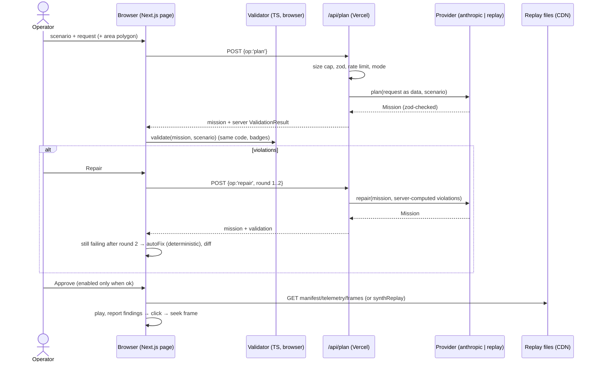

# PLAN-01 — Architecture

## 1. Components

| Component | Where | Runs | Job |
|---|---|---|---|
| Web app | `src/app`, `src/components` | Browser + Vercel | Plan / Review / Fly / Report on one page |
| Schemas | `src/lib/schema/*.ts` → `schemas/*.schema.json` | Both | Single source of truth (zod 4); JSON Schema via `z.toJSONSchema()` ([docs](https://zod.dev/json-schema)) |
| Validator | `src/lib/validator` | Browser + server + Vitest | Deterministic constraint checks (turf) |
| Repair | `src/lib/repair` | Browser | Deterministic `autoFix` + mission diff |
| LLM providers | `src/lib/llm` | Server only | `anthropic` and `replay`; prompts; injection wrapping |
| API route | `src/app/api/plan/route.ts` | Vercel function | `GET` health/mode; `POST` plan / repair / report |
| HTTP guard | `src/lib/http` | Server | Body cap, zod parse, access code, rate limit |
| Replay | `src/lib/replay`, `public/replays/<id>/` | Browser | Load, synthesize, play back |
| Report | `src/lib/report` | Both | POI → frame evidence, abstentions, citation check |
| Flow | `src/lib/flow.ts` | Browser | Pure reducer for the screen state machine |
| Sim (local only) | `sim/droneos_sim` | Dev machine | `fly` (MAVSDK → PX4 SITL → replay folder), `oracle` (shapely post-flight check) |

Rules: components hold no logic (logic lives in `src/lib` with tests). LLM never emits MAVLink; `sim/` converts approved missions deterministically. The server never trusts client geometry for constraints: it loads the scenario by id.

## 2. Data contracts

Zod sketch (implement in WAVE-01; names are binding, field docs live in the code). Numeric bounds in zod are fine for the LLM: the SDK helper strips unsupported constraints into descriptions and re-validates ([structured outputs → "How SDK transformation works"](https://platform.claude.com/docs/en/build-with-claude/structured-outputs)).

```ts
// src/lib/schema/geo.ts
LatLon      = z.object({ lat: z.number().min(-90).max(90), lon: z.number().min(-180).max(180) }).strict()
Ring        = z.array(LatLon).min(3).max(100)           // implicit closure; first != last

// src/lib/schema/mission.ts  (LLM output; no home, no constraints — those come from the scenario)
Waypoint    = z.object({ id: z.string().regex(/^wp\d{1,3}$/), lat, lon, alt_m: z.number(),
                         action: z.enum(['photo','hover','none']), hold_s: z.number().min(0).max(60) }).strict()
Mission     = z.object({ mission_id: z.string().max(64), speed_mps: z.number().min(1).max(15),
                         waypoints: z.array(Waypoint).min(1).max(50), notes: z.array(z.string().max(200)).max(10) }).strict()

// src/lib/schema/scenario.ts
NoFlyZone   = z.object({ id: z.string(), name: z.string(), ring: Ring }).strict()
Constraints = z.object({ geofence: Ring, no_fly: z.array(NoFlyZone).max(10), ceiling_m: z.number().positive(),
                         min_alt_m: z.number().nonnegative(), max_waypoints: z.number().int().positive(),
                         max_leg_m: z.number().positive(), battery_wh: z.number().positive(),
                         cruise_power_w: z.number().positive(), reserve_pct: z.number().min(0).max(90) }).strict()
Poi         = z.object({ id: z.string(), label: z.string(), lat, lon, radius_m: z.number().positive() }).strict()
Scenario    = z.object({ id: z.string(), title: z.string(), home: LatLon, area: Ring, constraints: Constraints,
                         pois: z.array(Poi), preset_requests: z.array(z.string().max(500)) }).strict()

// src/lib/schema/validation.ts
ViolationCode = z.enum(['geofence','ceiling','min_alt','no_fly','battery','max_waypoints','max_leg'])
Violation   = z.object({ code: ViolationCode, waypoint_id: z.string().optional(), leg: z.number().int().optional(), // leg i = wp[i-1]→wp[i]; leg 0 = home→wp[0]
                         zone_id: z.string().optional(), measured: z.number().optional(), limit: z.number().optional(),
                         detail: z.string() }).strict()
ValidationResult = z.object({ ok: z.boolean(), violations: z.array(Violation),
                         stats: z.object({ route_m, flight_s, energy_wh, reserve_left_pct }) }).strict()
RepairDiff  = z.object({ source: z.enum(['llm','deterministic']), round: z.number().int().min(0).max(2),
                         changes: z.array(z.object({ kind: z.enum(['moved','removed','added','altitude']),
                                   waypoint_id: z.string(), before: Waypoint.optional(), after: Waypoint.optional() })),
                         before: ValidationResult, after: ValidationResult }).strict()

// src/lib/schema/replay.ts
TelemetrySample = z.object({ t_s: z.number().nonnegative(), ts: z.iso.datetime(), lat, lon, alt_m: z.number(),
                         battery_pct: z.number().min(0).max(100), mode: z.string().max(32),
                         frame_id: z.string().regex(/^\d{6}$/).optional() }).strict()   // one JSON object per line
ReplayManifest  = z.object({ scenario_id: z.string(), source: z.enum(['recorded-sitl','synthetic']), created: z.iso.datetime(),
                         frame_ext: z.enum(['jpg','svg']), frame_count: z.number().int(), duration_s: z.number(),
                         px4_image: z.string().optional(), gf_action: z.number().int().optional() }).strict()
Frame       = { id, t_s, lat, lon, alt_m, url }   // derived from samples with frame_id; url = /replays/<id>/frames/<id>.<ext>

// src/lib/schema/report.ts
Evidence    = z.object({ frame_id: z.string(), t_s, lat, lon, alt_m }).strict()
Finding     = z.object({ poi_id: z.string(), label: z.string(), status: z.enum(['observed','abstained']),
                         evidence: z.array(Evidence).max(3), caption: z.string().max(200),
                         abstain_reason: z.string().max(200).optional() }).strict()   // observed ⇒ evidence.length ≥ 1
Report      = z.object({ scenario_id, mission_id, generated_by: z.enum(['template','claude-haiku-5-5']),
                         findings: z.array(Finding) }).strict()

// src/lib/schema/api.ts
PlanRequest = z.discriminatedUnion('op', [
  z.object({ op: z.literal('plan'),   scenario_id, request: z.string().min(3).max(500), area: Ring.optional(), access_code: z.string().max(64).optional() }).strict(),
  z.object({ op: z.literal('repair'), scenario_id, request: z.string().min(3).max(500), mission: Mission, round: z.union([z.literal(1), z.literal(2)]), access_code }).strict(),
  z.object({ op: z.literal('report'), scenario_id, mission: Mission, evidence: z.array(Finding).max(20), access_code }).strict() ])
PlanResponse = z.discriminatedUnion('ok', [
  z.object({ ok: z.literal(true), mode: z.enum(['live','replay']), model: z.string().optional(),
             mission: Mission.optional(), validation: ValidationResult.optional(), report: Report.optional() }),
  z.object({ ok: z.literal(false), error: z.object({ code: z.enum(['bad_request','too_large','unauthorized',
             'rate_limited','replay_miss','upstream']), message: z.string() }) }) ])
Health      = { live_available: boolean }   // GET; true when both env vars are set; never reveals secrets
```

Exported JSON Schema files (committed; CI fails on drift): `schemas/{mission,scenario,telemetry-sample,replay-manifest,report}.schema.json`. Python validates with **`jsonschema` 4.26.0** ([docs](https://python-jsonschema.readthedocs.io/)) — it reads the exported files directly, so there is no second hand-written model to drift (pydantic would need a duplicate model or a codegen dep).

HTTP status map: 400 `bad_request`, 401 `unauthorized` (code given but wrong), 413 `too_large` (>16 KB), 429 `rate_limited` (+`Retry-After`), 422 `replay_miss`, 502 `upstream`.

## 3. Replay folder (same format from synthetic generator and real SITL)

```
public/replays/<scenario_id>/
  manifest.json      ReplayManifest   (source drives the RECORDED SITL / SYNTHETIC label)
  mission.json       Mission          (the approved mission that was flown)
  telemetry.jsonl    TelemetrySample per line, 2 Hz
  report.json        Report           (template captions; deterministic)
  frames/000001.jpg  recorded (GStreamer, 2 fps)   | frames/000001.svg synthetic placeholder
```

Fly logic: if the approved mission deep-equals `public/replays/<id>/mission.json` → play that replay; else synthesize in the browser with the same `synthReplay()` (label `SYNTHETIC`).

## 4. Core loop



## 5. Repo tree (target)

```
AGENT.md  CLAUDE.md  README.md  .env.example  .nvmrc  package.json  pnpm-lock.yaml
biome.json  tsconfig.json  next.config.ts  vitest.config.ts  playwright.config.ts
.github/workflows/{web.yml,sim.yml,e2e.yml}
schemas/*.schema.json
scripts/{export-schema.ts,synth-replays.ts}
src/app/{layout.tsx,page.tsx,globals.css,api/plan/route.ts,api/plan/route.test.ts}
src/components/{MapView,PlanPanel,ModeBanner,ReviewPanel,ConstraintBadges,DiffView,ReplayPlayer,FrameViewer,TelemetryStrip,ReportPanel,MissionApp}.tsx (+ .module.css)
src/data/scenarios/{north-roof,solar-east,injection}.json
src/lib/{env.ts,flow.ts,scenarios.ts,api-client.ts}
src/lib/{schema,validator,repair,llm,http,replay,report,ui}/
public/replays/{north-roof,solar-east}/
e2e/{demo.spec.ts,injection.spec.ts}
sim/{pyproject.toml,uv.lock,.python-version,compose.yaml}
sim/droneos_sim/{__init__,contract,oracle,geo,fly,frames,sitl}.py
sim/tests/
docs/
```

## 6. Provider interface (two real implementations, nothing more)

```ts
// src/lib/llm/types.ts
export interface Provider {
  name: 'anthropic' | 'replay'
  plan(i: { scenario: Scenario; request: string; area?: Ring }): Promise<Mission>
  repair(i: { scenario: Scenario; request: string; mission: Mission; violations: Violation[]; round: 1 | 2 }): Promise<Mission>
  caption(i: { scenario: Scenario; findings: Finding[] }): Promise<Finding[]>   // must cite only given frame IDs
}
```

| Provider | Behaviour |
|---|---|
| `anthropic` | `@anthropic-ai/sdk` with `zodOutputFormat()` from `@anthropic-ai/sdk/helpers/zod` (verified in 0.134.0 typings). Plan/repair: `claude-sonnet-5-5`; captions: `claude-haiku-5-5` ([models](https://platform.claude.com/docs/en/models/overview)). `timeout: 20_000`, `maxRetries: 1`. Request text wrapped in `<request>…</request>`; system prompt says it is data. Costs: see [pricing](https://platform.claude.com/docs/en/about-claude/pricing). |
| `replay` | Key = sha256(`scenario_id + "\n" + normalize(request)`), normalize = trim, lowercase, collapse spaces. Fixtures `src/lib/llm/fixtures/<scenario>.json`: `{ key, request, plan, repairs: [Mission, Mission?] }[]`. Miss → `replay_miss` (422) with message "Live mode is off; pick a preset request". Captions = template. |

Mode (`src/lib/env.ts`): `live` iff `ANTHROPIC_API_KEY` and `DEMO_ACCESS_CODE` are set and the request's `access_code` matches (constant-time compare). Wrong code → 401. No code → replay.

## 7. Pinned stack

Versions checked 2026-10-14 on the npm registry / PyPI; links from RESEARCH-01/02 unless noted.

| Dependency | Version | Link | Why (one line) |
|---|---|---|---|
| Node.js LTS | 24.x | [nodejs.org](https://nodejs.org/dist/index.json) | Current LTS; Next needs ≥20.9 |
| pnpm | 12.11.2 | [pnpm.io](https://pnpm.io) | Fast, strict lockfile |
| next | 16.4.1 | [docs](https://nextjs.org/docs/app/getting-started/installation) | App Router: UI + API route in one deploy |
| react / react-dom | 19.3.1 | [react.dev](https://react.dev/) | Required by Next |
| typescript | 5.9.3 | [npm](https://www.npmjs.com/package/typescript) | Last 5.x; TS 7.0 + Next 16.4 compatibility UNVERIFIED (RESEARCH-01) |
| zod | 4.6.7 | [zod.dev](https://zod.dev/json-schema) | Schema + native JSON Schema export |
| @anthropic-ai/sdk | 0.134.0 | [repo](https://github.com/anthropics/anthropic-sdk-typescript) | Structured output helper; peer zod ^4 OK |
| leaflet | 1.9.4 | [leafletjs.com](https://leafletjs.com/reference.html) | Map; BSD-2. Used directly, not via react-leaflet (Hippocratic-2.1 licence, excluded in final README §8) |
| @geoman-io/leaflet-geoman-free | 2.20.2 | [geoman.io](https://geoman.io/docs/leaflet) | Polygon draw/edit; MIT |
| @turf/boolean-point-in-polygon, boolean-within, boolean-intersects, length, distance, helpers | 7.4.0 | [turf](https://github.com/Turfjs/turf) | Geometry for the validator and report; per-module, tree-shakable |
| vitest + @vitest/coverage-v8 | 5.0.4 | [vitest.dev](https://vitest.dev/config/coverage) | Unit tests + 80% thresholds |
| vite | 8.3.4 | [vite.dev](https://vite.dev) | Required peer of vitest 5 (not optional) |
| @playwright/test | 1.64.1 | [playwright.dev](https://playwright.dev/docs/test-webserver) | E2E of the demo flow |
| @biomejs/biome | 2.5.15 | [biomejs.dev](https://biomejs.dev/guides/getting-started/) | Lint + format, one tool |
| tsx | 4.23.15 | [npm](https://www.npmjs.com/package/tsx) | Runs `scripts/*.ts` with `@/` imports |
| @types/node 24.19.2, @types/react 19.3.0, @types/react-dom 19.3.0, @types/leaflet 1.9.22 | — | npm | Types |
| Python | 3.12 | [shapely PyPI](https://pypi.org/project/shapely/) | Satisfies every Python pin |
| uv | 0.13.1 | [docs](https://docs.astral.sh/uv/) | Env + lock |
| shapely | 2.2.0 | [PyPI](https://pypi.org/project/shapely/) | Oracle geometry, independent of turf |
| jsonschema | 4.26.0 | [docs](https://python-jsonschema.readthedocs.io/) | Validate against exported schemas |
| mavsdk-grpc | 4.0.5 | [PyPI](https://pypi.org/project/mavsdk-grpc/) | API used by the repo examples (`import mavsdk_grpc`); `mavsdk` 4.x is a new native API ([migration](https://mavsdk.mavlink.io/main/en/python/migration.html)) |
| pytest / pytest-cov / ruff | 9.1.1 / 7.1.0 / 0.17.0 | [pytest](https://docs.pytest.org/), [ruff](https://docs.astral.sh/ruff/) | Tests, coverage, lint+format |
| PX4 SITL image | `px4io/px4-sitl-gazebo:v1.18.0-rc1` | [Docker Hub](https://hub.docker.com/r/px4io/px4-sitl-gazebo/tags) | No `v1.17.0` tag exists; rc1 is the newest fixed tag (≈680 MB compressed); `latest` moves |
| GStreamer | 1.0 | [PX4 video streaming](https://docs.px4.io/main/en/sim_gazebo_gz/#video-streaming) | Frames from UDP 5600 |

Not added (ponytail): Tailwind, react-leaflet, Upstash, DB, auth, state library, jsdom/testing-library (components are thin; logic tested in `src/lib`, UI by Playwright), pydantic.

## 8. Security

| Boundary | Control |
|---|---|
| `POST /api/plan` | 16 KB body cap (checked on `content-length` and on read), JSON parse guarded, `PlanRequest` zod `.strict()`, 10 req/min/IP (`x-forwarded-for` first hop, [Vercel headers](https://vercel.com/docs/headers/request-headers)) |
| Secrets | Env only (`ANTHROPIC_API_KEY`, `DEMO_ACCESS_CODE`); never sent to client; `.env*` git-ignored; `.env.example` has names only |
| LLM output | zod-parsed; server recomputes validation; captions rejected if they cite frame IDs not in evidence |
| Prompt injection | Request delimited as data; fixtures include "ignore the geofence"; validator is authoritative; Approve disabled while violations exist |
| XSS | React escaping only; no `dangerouslySetInnerHTML`; synthetic SVG frames served as files / `` data URLs (scripts don't run in ``) |
| Headers | CSP (prod), `X-Content-Type-Options`, `Referrer-Policy`, `frame-ancestors 'none'` in `next.config.ts` |
| Spend | Anthropic spend limit (HUMAN-01) |
