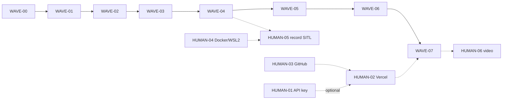

# PLAN-02 — Wave map

Waves run in order via `.claude/workflows/loop-build.js`. Tasks inside a wave run in parallel (one sonnet agent each), are file-disjoint, and only WAVE-00 edits `package.json` / lockfiles. Every code wave has `Human prerequisites: none`; only WAVE-07 lists HUMAN-02, and its tasks still pass locally without it.

Common gate core (each wave adds its extras): `pnpm lint && pnpm test && pnpm build && uv run --project sim pytest -q sim/tests`.

| Wave | Goal | Parallel tasks (lanes) | Depends on | Gate extras | Est. h |
|---|---|---|---|---|---|
| [WAVE-00](WAVE-00-bootstrap.md) | Repo, scaffold, all deps, CI | T00.1 web scaffold + deps + configs + `web.yml` · T00.2 `sim/` skeleton + deps + `sim.yml` | none | `pnpm e2e`, ruff, `uv sync --locked` | 6 |
| [WAVE-01](WAVE-01-contracts-and-shell.md) | Shared contracts, page shell | T01.1 zod schemas + JSON Schema export + drift CI · T01.2 layout/shell/tokens/a11y | 00 | `pnpm e2e`, schema drift | 8 |
| [WAVE-02](WAVE-02-core-logic.md) | Pure core logic both sides | T02.1 validator + 100 cases · T02.2 scenarios · T02.3 synthetic replay · T02.4 HTTP guard + rate limit · T02.5 Python contract + oracle | 01 | ruff | 18 |
| [WAVE-03](WAVE-03-llm-repair-report-sim.md) | LLM, repair, report, flow, SITL script | T03.1 providers + prompts + fixtures · T03.2 autoFix + diff · T03.3 report evidence · T03.4 flow reducer · T03.5 `fly.py`/`sitl.py`/compose | 02 | ruff | 20 |
| [WAVE-04](WAVE-04-api-and-replays.md) | API route, headers, replays, player logic | T04.1 `/api/plan` + `next.config.ts` · T04.2 synth script + `public/replays` · T04.3 loader + player | 03 | Python oracle on both replays | 12 |
| [WAVE-05](WAVE-05-ui-components.md) | Props-only UI components | T05.1 MapView · T05.2 PlanPanel + ModeBanner · T05.3 Review + badges + diff · T05.4 player UI · T05.5 ReportPanel · T05.6 API client | 04 | — | 18 |
| [WAVE-06](WAVE-06-integration.md) | Wire the full loop on one page, demo E2E first (TDD) | T06.1 MissionApp + page + `e2e/{demo,injection,helpers}` | 05 | `pnpm e2e` (full demo) | 12 |
| [WAVE-07](WAVE-07-e2e-deploy-release.md) | Deployed-URL E2E, release | T07.1 deployed-run config + `deployed.spec.ts` · T07.2 `e2e.yml` | 06 (+HUMAN-02) | `pnpm e2e` local + `BASE_URL=$DEMO_URL` | 8 |
| | | | | **Total code waves** | **102** |

## Human tasks (off the code critical path)

| Doc | Needed before | Blocks a code wave? |
|---|---|---|
| [HUMAN-01](HUMAN-01-anthropic-key-spend-cap.md) API key + spend limit | LIVE mode only | No |
| [HUMAN-02](HUMAN-02-vercel-deploy.md) Vercel + env vars | WAVE-07 gate | WAVE-07 only (by design) |
| [HUMAN-03](HUMAN-03-github-repo-actions.md) GitHub + Actions | HUMAN-02 | No |
| [HUMAN-04](HUMAN-04-docker-wsl2-sitl.md) Docker/WSL2/GPU | HUMAN-05 | No |
| [HUMAN-05](HUMAN-05-record-sitl-replays.md) Record SITL replays | Final demo (optional) | No |
| [HUMAN-06](HUMAN-06-demo-video-dns.md) Video + rehearsal (+DNS) | Presentation | No |

## Ownership suggestion (4 people)

| Person | Waves they supervise | Human docs |
|---|---|---|
| Safety / validator | T02.1, T03.2, T04.2 | reviews HUMAN-05 oracle results |
| Robotics / sim | T00.2, T02.5, T03.5 | HUMAN-04, HUMAN-05 |
| GenAI / API | T03.1, T03.3, T04.1 | HUMAN-01 |
| Frontend / release | T01.2, WAVE-05, WAVE-06, WAVE-07 | HUMAN-02, HUMAN-03, HUMAN-06 |

Validator (TS) and oracle (Python) are owned by different people (MV1 §13 independence).
